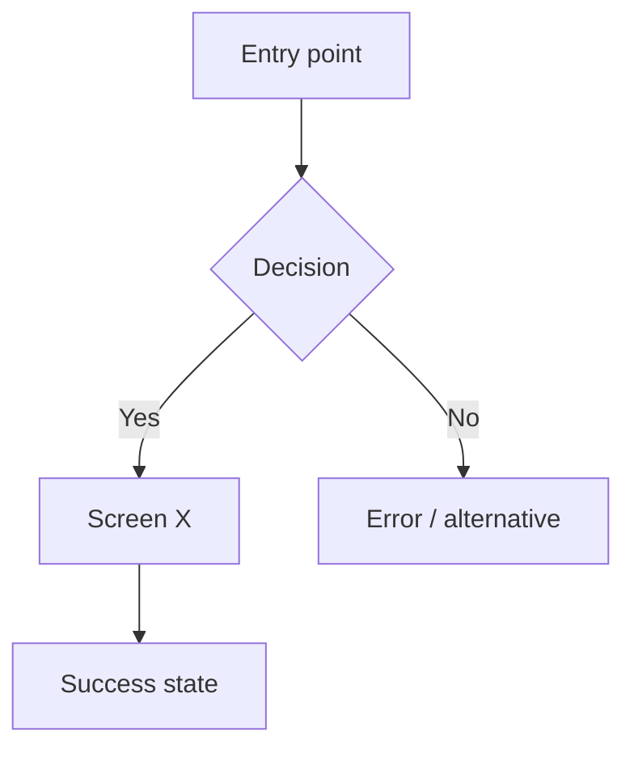

# UX/UI Design Spec: [Project / Module Name]

**Version:** 1.0 · **Date:** [YYYY-MM-DD] · **Author:** [Name]
**Mode:** A — Existing product ([stack detected]) / B — New product (React + Tailwind + shadcn/ui)
**Design System:** [link to Design System artifact / path to tokens file]
**Mockups:** [link to Design artifact / path to HTML mockups]

---

## 1. Context
- **Users & frequency:** [personas, daily power users vs occasional]
- **Devices & context of use:** [desktop at reception, tablet in consulting room…]
- **Locale:** [language, date format, currency, document types]
- **Upstream docs:** [PRD, functional specs, measurement plan]

## 2. User Flows

### Flow 1: [Job name]

## 3. Information Architecture

### Screen inventory
| ID | Screen | Purpose | Roles allowed | Entry point(s) |
|---|---|---|---|---|
| S01 | | | | |

### Navigation model
- Global: [sidebar / top bar] · Contextual: [tabs / breadcrumbs] · Back paths: [...]

## 4. Design System

### Tokens
| Category | Token (name in code) | Value | Usage |
|---|---|---|---|
| Color | | | |
| Typography | | | |
| Spacing | | | |
| Radius / shadow | | | |

### Component inventory
| Component | Source (existing path / shadcn / new) | Variants | States |
|---|---|---|---|

### Design debt (Mode A only)
| Issue | Example | Priority |
|---|---|---|

## 5. Screens

### S01 — [Screen name]
- **Purpose:** [...]
- **Layout:** [regions, priority content above the fold]
- **Data shown:** [field → source API]
- **Actions:** [action → result]
- **States:** default · empty · loading · error · no permission · success
- **Responsive:** [behavior at key breakpoints]
- **Analytics events:** [from measurement plan]
- **Accessibility notes:** [focus order, labels, announcements]
- **Mockup:** [artboard link / file]

## 6. Component Map (handoff to technical-specs)

| Screen | UI element | Component | Props / data | New? |
|---|---|---|---|---|
| S01 | Patient list | DataTable | columns, filters, pagination | No |

### New components
| Component | Purpose | Props | States | Accessibility |
|---|---|---|---|---|

## 7. Accessibility Requirements (WCAG 2.2 AA)
- [ ] Text contrast ≥ 4.5:1; large text and UI components ≥ 3:1
- [ ] Full keyboard operation; visible focus; logical tab order
- [ ] Every input has a label; errors linked to inputs and announced
- [ ] Target size ≥ 24×24 px
- [ ] No information by color alone
- [ ] Headings structure each page; landmarks present
- [ ] Status messages (save, error) announced to screen readers

## 8. Usability Test Plan
- **Participants:** 5 × [persona]
- **Tasks:**
  1. [Task] — success = [completion without help, < N min, ≤ 1 error]
- **Redesign trigger:** [e.g., ≥ 2 of 5 fail a task]

## 9. Implementation Guidance
- **Stack setup:** [Mode A: existing libraries and tokens to import / Mode B: greenfield setup checklist]
- **Impeccable:** [Mode A: diagnostic only — critique/audit / Mode B: full use]
- **Open decisions:** [...]
